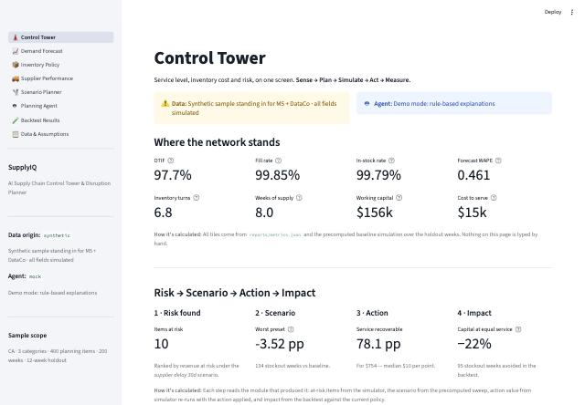
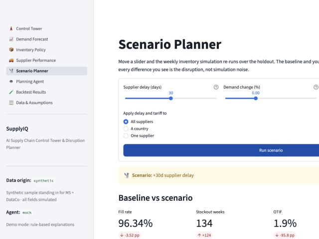

# SupplyIQ — AI Supply Chain Control Tower & Disruption Planner

Planners are asked to hold service level, cut inventory and absorb disruption at the same time, and
the three trade off against each other. The usual tooling reports what already happened, so the
trade is made on instinct. SupplyIQ makes it explicit: it forecasts demand, sets an inventory policy
per SKU, simulates a disruption, prices each possible response, and shows what service and working
capital you get for the money.

**Live demo:** 

<https://supplyiq-duzke3qfc7dgxvc4mvrcck.streamlit.app/>


**Status:** complete — all five modules built, 300+ tests, deployable to Streamlit Community Cloud

---

## Key metrics

<!-- METRICS:START -->
<!-- generated by scripts/render_readme.py from reports/metrics.json at 2026-11-22T23:13:58Z — do not edit by hand -->

Demand data is **synthetic placeholder**. Supplier lead times, unit costs, freight and tariff rates are **simulated** on top of it, from `config/assumptions.yaml`.

| Metric | Value | Source |
| --- | --- | --- |
| Planning items (SKU × store) | 400 | simulated |
| Weeks of history | 200 (2023-01-07 → 2026-10-31) | simulated |
| Holdout window | weeks 188–199 (never used in training) | method |
| Total units sold | 529,978 | simulated |
| Weeks with zero demand | 21.6% | simulated |
| Median demand CV per item | 0.71 | derived |
| Suppliers | 8 | simulated |
| Historical OTIF | 94.4% | simulated |
| Late-delivery rate | 2.5% | simulated |
| Mean inbound lead time | 17.9 days | simulated |
| Mean landed cost / unit | $4.31 | simulated |
| Landed vs. ex-works cost uplift | 25.7% | simulated |
| Items exposed to tariffs | 46.0% (184 items) | simulated |

**Forecast accuracy** — fitted on the training weeks, scored on the untouched holdout.

| Model | WAPE | MAPE | Bias | RMSE |
| --- | --- | --- | --- | --- |
| `seasonal_naive` (baseline) | 0.550 | 0.658 | -0.034 | 6.58 |
| `ets` (candidate) | **0.461** | 0.518 | -0.009 | 5.34 |

The candidate takes **9.0 percentage points** off the baseline's WAPE, a 16% relative improvement. 1060 of 4800 holdout weeks had zero sales and are excluded from MAPE; WAPE keeps every unit of demand in the denominator.

**Inventory policy** — at the configured service levels (A 98%, B 95%, C 90%).

| Metric | Value |
| --- | --- |
| Projected fill rate (demand weighted) | 99.81% |
| Portfolio inventory turns | 6.8 |
| Median weeks of supply | 8.0 |
| Total safety stock | 7,205 units ($34,356) |
| Average inventory value | $91,633 |
| **Safety stock added by lead-time variability** | **+26.6%** vs. a demand-only formula |

That last row is the point of the PLAN module: ignoring lead-time variability — which a flat weeks-of-cover rule does — would under-protect this portfolio by 26.6% of its safety stock, concentrated on the long overseas lanes.

**Disruption scenarios** — 12 simulated weeks, baseline vs. shock.

| Scenario | Fill rate | Δ pp | Stockout weeks | OTIF | Working capital | Cost to serve |
| --- | --- | --- | --- | --- | --- | --- |
| No disruption | 99.85% | — | 10 | 97.7% | $156,204 | $14,938 |
| +14d supplier delay | 98.61% | -1.24 | 62 | 43.9% | $156,350 | $15,029 |
| +30d supplier delay | 96.34% | -3.52 | 134 | 1.9% | $156,553 | $15,753 |
| +25% demand | 99.08% | -0.77 | 35 | 98.0% | $153,245 | $17,737 |
| +50% demand | 98.04% | -1.81 | 69 | 99.2% | $150,351 | $21,296 |
| +10pp tariff (CN) | 99.85% | +0.00 | 10 | 97.7% | $161,038 | $15,157 |
| +10pp tariff | 99.85% | +0.00 | 10 | 97.7% | $168,026 | $15,477 |
| +21d supplier delay, +25% demand, +10pp tariff (CN) | 98.50% | -1.35 | 49 | 90.1% | $158,117 | $18,140 |

Cost to serve is holding + stockout + ordering + action costs. Tariff changes are percentage points added to the ad-valorem rate, floored at zero.

**Backtest** — SupplyIQ policy vs. the policy a planner runs today (naive forecast, flat weeks of cover), same simulator, same weeks, same lead-time draws.

| Metric | Current | SupplyIQ | Change |
| --- | --- | --- | --- |
| Fill rate | 95.36% | 99.85% | **+4.50 pp** |
| Stockout weeks | 105 | 10 | **−95 (90%)** |
| Units short | 1,450 | 46 | -1,403 |
| Working capital | $106,312 | $156,204 | +46.9% |
| Cost to serve | $16,714 | $14,938 | -10.6% |

At their default settings SupplyIQ buys a lot more service for more capital. The like-for-like question is what each policy must hold to reach the SAME fill rate, so both are swept — SupplyIQ across service levels, the flat rule across weeks of cover:

> **At equal service, the SupplyIQ policy needs 22% less working capital** (range 8.7%–37.0% across 4 comparable fill rates between 98.9% and 99.9%). 5 swept points fall below the range where both policies can operate and are excluded rather than averaged in.

**The finding worth the write-up:** Driving the SupplyIQ service level to 0.50 removes its safety stock entirely, and it still beats the flat rule's fill rate. The advantage is therefore not the safety stock -- it is reordering against each item's own lead time, which a flat weeks-of-cover rule cannot do.

**Planning agent** — under the *supplier delay 30d* scenario, 10 at-risk items, each action priced by re-running the simulator:

- Action mix: 5× expedite order, 4× switch supplier, 1× no action
- Total service recovered: **78.1 pp** of fill rate for **$754**
- Median cost per point of fill rate: **$10**

The language model writes the explanation, never the numbers — and generated text containing a figure the simulator did not produce is discarded automatically.

_Phases complete: 1, 2, 3, 4 of 5. The Streamlit pages and the live demo land in Phase 5._

<!-- METRICS:END -->

Every figure above is produced by `make metrics`, which writes `reports/metrics.json`, and this
block is rendered from that file by `scripts/render_readme.py`. No number in this README is typed
by hand, and `make test` fails if the block drifts from the file.

---

## Screenshots



*Control Tower — KPI tiles and the one-screen story: risk found → scenario → action → impact.*



*Scenario Planner — a 30-day supplier delay, re-simulated live. Fill rate 99.85% → 96.34%,
OTIF 97.7% → 1.9%.*

---

## What it does

Five steps, which are also the five modules:

| Step | Module | What it produces |
| --- | --- | --- |
| **Sense** | `supplyiq/forecast`, `supplyiq/suppliers` | Weekly demand forecast per SKU (8–12 weeks), measured against a seasonal-naive baseline on a time-based holdout. Supplier lead time, variability, OTIF and late-delivery rate. |
| **Plan** | `supplyiq/inventory` | ABC/XYZ segmentation, safety stock accounting for demand *and* lead-time variability, reorder point, EOQ, weeks of supply, projected fill rate at a chosen service level. |
| **Simulate** | `supplyiq/simulate` | A weekly inventory twin. Three disruption sliders — supplier delay, demand spike, tariff change — against a baseline, reporting stockout weeks, fill rate, OTIF, inventory value and landed cost. |
| **Act** | `supplyiq/agent` | Per at-risk SKU: expedite, rebalance, switch or dual-source, or adjust order quantity. Each option's cost and service impact comes from re-running the simulator with the action applied. Approve/reject, logged. |
| **Measure** | `supplyiq/kpis` | Backtest of the SupplyIQ policy against a naive current policy on history: stockouts avoided, fill-rate change, inventory reduction at equal service. |

Intended users: demand planner, inventory planner, procurement manager, and an operations leader
who wants one screen.

---

## Real vs. simulated data

This matters for reading any number in the app, so it is labelled everywhere — in the UI badge, in
`data/sample/provenance.json`, and in the metrics table above.

**Real, when the Kaggle files are present:**

- [M5 Forecasting – Accuracy](https://www.kaggle.com/competitions/m5-forecasting-accuracy) —
  Walmart daily unit sales, the retail calendar and real sell prices. Aggregated to Saturday-start
  retail weeks, matching Walmart's own `wm_yr_wk` definition.
- [DataCo Smart Supply Chain](https://www.kaggle.com/datasets/shashwatwork/dataco-smart-supply-chain-for-big-data-analysis) —
  shipping mode mix, order regions and realised late-delivery rate.

**Simulated, always, from `config/assumptions.yaml`:**

- The supplier master: eight suppliers across CN, VN, MX and US, with mean lead time, lead-time
  standard deviation, OTIF target, MOQ and order multiple. Neither dataset contains a vendor
  dimension or a purchase lead time, so this is declared rather than learned. Realised lead times
  and OTIF in the sample are checked against these targets by the test suite.
- The cost stack:
  `unit_cost = avg_sell_price × (1 − gross_margin_target) × supplier.unit_cost_index`, and
  `landed_cost = unit_cost + freight_per_unit + unit_cost × tariff_rate`.
- Tariff rates by country, freight per unit, holding cost rate, stockout penalty, ordering cost.

If no Kaggle files are present, `make ingest` builds a **synthetic sample** with the same schema so
the repo runs and deploys out of the box. It is labelled `synthetic` in the provenance file and
raises a warning badge in the UI — it is never presented as real data.

### Getting the real data

```bash
make download-data   # needs ~/.kaggle/kaggle.json; see below
make ingest-real     # rebuild data/sample/ from the raw files
make metrics         # recompute every reported number
```

Before the first download, two one-time steps on kaggle.com that only the account holder can do:

1. **Settings → API.** Either option works:
   - *Generate New Token* (recommended) — save the `KGAT_…` value:
     ```bash
     mkdir -p ~/.kaggle && echo "KGAT_..." > ~/.kaggle/access_token && chmod 600 ~/.kaggle/access_token
     ```
     This needs `kaggle` CLI ≥ 1.8.0, which `make download-data` installs.
   - *Create Legacy API Key* — downloads `kaggle.json`:
     ```bash
     mkdir -p ~/.kaggle && mv ~/Downloads/kaggle.json ~/.kaggle/ && chmod 600 ~/.kaggle/kaggle.json
     ```
2. **Accept the M5 competition rules.** Open the
   [competition page](https://www.kaggle.com/competitions/m5-forecasting-accuracy) and click
   **Late Submission**, which is what presents the terms. The download returns HTTP 403 until this
   is done — the competition appearing in search results does not mean the rules were accepted.
   DataCo is a plain CC0 dataset and needs no acceptance.

Raw Kaggle files are gitignored and never committed, for licence and size reasons. Only the small
processed sample in `data/sample/` is in the repo.

**A note on PII.** The DataCo file carries real-looking customer names, emails, street addresses and
plaintext passwords. The ingest reads five operational columns from it — shipping mode, order
region, scheduled and actual shipping days, late-delivery flag — and nothing else. Two tests assert
that no PII column is referenced by the ingest or present in the committed sample.

---

## Running it

```bash
make setup   # python 3.11 venv, pinned deps, builds data/sample/
make run     # start Streamlit at http://localhost:8501
```

Other targets:

```bash
make test           # full test suite
make metrics        # recompute reports/metrics.json and the README block
make ingest         # rebuild the data sample
make check-deploy   # fresh venv with runtime deps only, boots the app headless
make help           # list every target
```

Python 3.11 is required. No conda, no system packages.

### The AI agent is optional

The planning agent sits behind a provider interface with a rule-based fallback, so the app, the
tests and the deployed demo all run **with no API key**. With no key configured you get
`Demo mode: rule-based explanations`.

The agent only ever writes prose. Every number in a recommendation is computed by the inventory
simulator. That is enforced, not just prompted: generated text is checked against the simulator's
output by `supplyiq/agent/guard.py`, and any text containing a figure the simulator did not produce
is discarded in favour of the rule-based explanation. To use a live model, copy
`.streamlit/secrets.toml.example` to `.streamlit/secrets.toml` and add a key.

---

## Reproducibility

- Every planning parameter lives in `config/assumptions.yaml`. A test fails the build if one is
  hard-coded in the package instead.
- Every reported number is written by `make metrics` into `reports/metrics.json`.
- The data sample is built from a fixed seed, so `make ingest` is byte-identical between runs.
- Forecast evaluation uses a time-based holdout: train on earlier weeks, test on the final weeks.
  A test asserts the two sides never overlap.

---

## Repository layout

```
streamlit_app.py          Control Tower — the Streamlit Cloud entry point
pages/                    the other Streamlit pages
app/                      shared UI components (cached loaders, badges, captions)
supplyiq/                 core package
  config.py               loads and validates config/assumptions.yaml
  schemas.py              the schema contract for data/sample/
  data.py                 cached reads, provenance, the train/test split
  ingest.py               the real-Kaggle and synthetic ingest paths
  agent/                  provider interface, rule-based mock, numeric guard
config/assumptions.yaml   every simulated parameter, in one place
data/sample/              the committed processed sample (Parquet) + provenance.json
data/raw/                 raw Kaggle downloads (gitignored)
reports/metrics.json      every reported number
scripts/                  ingest.py, metrics.py, download_data.sh, check_deploy.sh
tests/                    pytest suite
docs/PRD.md               problem, users, scope, KPIs, roadmap
```

---

## Deploying to Streamlit Community Cloud

The repo is built for this: a root entry point, a pinned runtime-only `requirements.txt`,
a committed sample well under the size budget, `@st.cache_data` on every load, and
precomputed results so the app never fits a model at runtime.

**Before you start**, check locally that the app boots on runtime dependencies alone:

```bash
make check-deploy
```

That builds a fresh virtualenv with only `requirements.txt`, runs the app headless for
20 seconds, and fails if anything errors or if the health endpoint does not answer. It is
the same thing Streamlit Cloud does, so if it passes here it will almost certainly deploy.

### Step by step

1. **Push to a public GitHub repo.**
   ```bash
   git remote add origin https://github.com/<you>/supplyiq.git
   git push -u origin main
   ```
   Confirm `data/sample/*.parquet`, `data/derived/*.parquet` and `reports/metrics.json`
   are committed — the app reads them at runtime and will show a friendly "data not
   available" message without them. `data/raw/` is gitignored and must stay that way.

2. Go to **[share.streamlit.io](https://share.streamlit.io)** and sign in with the
   **GitHub** account that owns the repo. Authorise Streamlit when GitHub asks.

3. Click **Create app**, then **Deploy a public app from GitHub**.

4. Fill in the form:
   - **Repository:** `<you>/supplyiq`
   - **Branch:** `main`
   - **Main file path:** `streamlit_app.py`

5. Open **Advanced settings** and set **Python version** to **3.11**. The pinned
   dependencies are resolved against 3.11; leaving it on the default can produce a
   version of pandas or pyarrow these pins do not match.

6. Still in Advanced settings, **Secrets** is optional. Leave it empty and the app runs
   in demo mode with rule-based explanations. To use a live model, paste:
   ```toml
   ANTHROPIC_API_KEY = "sk-ant-..."
   ```
   Never commit that file — `.streamlit/secrets.toml` is gitignored, and
   `.streamlit/secrets.toml.example` is the committed template.

7. Click **Deploy**. The first build takes two to four minutes.

8. Set a custom subdomain: **⋮ → Settings → General → App URL**, e.g.
   `supplyiq-<yourname>`. Put the resulting link at the top of this README.

   This repo is deployed at <https://supplyiq-duzke3qfc7dgxvc4mvrcck.streamlit.app/>.

### If the deploy fails

| Symptom in the log | Cause | Fix |
| --- | --- | --- |
| `ModuleNotFoundError` | A dev-only package is imported at runtime | It belongs in `requirements-dev.txt`; `make check-deploy` reproduces this locally |
| `ERROR: Could not find a version that satisfies...` | Python version mismatch | Set Python 3.11 in Advanced settings |
| App shows "Data not available" | The Parquet sample was not committed | `git add -f data/sample data/derived reports` and push |
| `This app has gone over its resource limits` | Memory | The committed sample is ~0.8 MB and pages load column projections; if you enlarge the sample, shrink `sample.n_items` in `config/assumptions.yaml` and re-run `make ingest && make metrics` |
| Blank page, no error | Entry point wrong | Main file path must be exactly `streamlit_app.py` |

Paste any deploy error back and it can be diagnosed against the build log.

### What the deployed app does and does not do

- Forecasts, inventory policy, scenarios, recommendations and the backtest are
  **precomputed** by `make metrics` and committed, so startup is fast.
- The **Scenario Planner re-runs the simulator live** — the whole 400-item panel takes
  about 30 ms, so the sliders are genuinely interactive.
- Approve/reject decisions live in `st.session_state` with a CSV download. **They are not
  persisted**; Streamlit Cloud resets the filesystem on redeploy.
